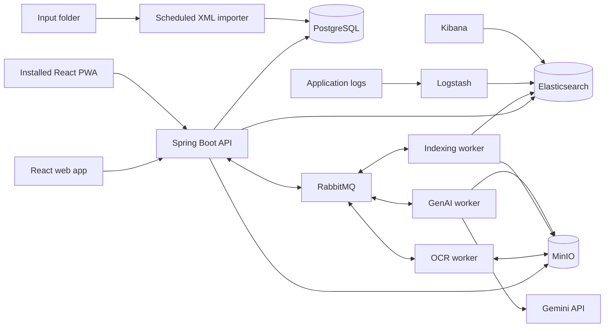

# DocFlow architecture

This document records the intended architecture and agreed course requirements, not implementation progress. Keep the design learning-focused rather than production-ready. See the [sprint summary](sprint-summary.md) for delivered functionality and verification, the [Sprint 2 tracker](sprint-2-progress.md) for task progress, and [README](../README.md) for verified usage commands.

## 1. Confirmed choices

- Repository: **DocFlow**; Java/Spring Boot backend and React frontend in the same repository.
- Deployment: **managed Docker container platform, no VPS**; automatic CI with manually triggered deployment/shutdown workflows and **scheduled testing/demonstrations**, not continuous hosting. **EUR 10/month maximum for the whole team**, including taxes/usage/AI. Railway is the recommended candidate, subject to a measured trial and account limits.
- Team: **three students**, explicitly reconfirmed by the user on 14 October 2026.
- Classification: **multiple labels per document, mandatory user confirmation**; live LLM integration in Sprint 5, not Sprint 1.
- Accounts: **admin-created accounts only**, username-or-email/password login, **no public registration page or endpoint**.
- Additional use case: **automatic document classification using an LLM**.
- Versions: latest LTS when available; otherwise latest stable compatible releases, excluding previews.
- Accepted defaults: owner-only document access, admin-maintained seven-label taxonomy, Gemini provider and Railway scheduled sessions with one hosting administrator.
- Mobile deliverable: **React PWA**, confirmed by the user on 14 October 2026 as satisfying the smartphone-app requirement. No separate native/Capacitor project.
- Infrastructure: pinned MinIO source build accepted; **Elasticsearch, Logstash and Kibana in containers both locally and during cloud sessions**. No continuous cloud operation.
- Database schema: **`spring.jpa.hibernate.ddl-auto=update`**, the agreed development policy. Hibernate applies supported schema changes at application startup while retaining existing rows. No Flyway migrations are planned.

Recommend a layered REST application with separate OCR, indexing and GenAI worker applications, plus a scheduled batch application. PostgreSQL owns structured data, MinIO stores files, Elasticsearch provides search, and RabbitMQ connects asynchronous processing. The course diagram explicitly specifies a monorepo with subprojects.

### Student-project scope

Docker Compose is the primary development and grading environment. Keep the required application layers, workers, infrastructure and functional deliverables, but use straightforward implementations that the whole team can explain. Cloud demonstrations remain planned within the budget, using manual workflow triggers. Defer transactional outbox processing, distributed deletion orchestration, classification history, generic PATCH support, shared adapter frameworks and advanced hardening until a demonstrated need justifies them. The accepted reliability limitations are described below.

## 2. Course requirements and evidence

| Course requirement | Design response |
| --- | --- |
| JDK LTS >=25, Spring Boot >=3.5/4 | Java 25 LTS and Spring Boot 4.1.1 |
| REST, PostgreSQL ORM, repository pattern | Spring MVC, Spring Data JPA, Hibernate-generated tables (`ddl-auto=update`) |
| Separate business and persistence entities; mapping framework | HTTP DTOs, business models, JPA entities, MapStruct |
| Business components through interfaces; DI and validation | Application services, ports/adapters, constructor injection, Jakarta validation |
| Upload, edit, delete, metadata, tags | Document API and React dashboard/detail views |
| Full-text and fuzzy search | Elasticsearch projection and search service agent |
| RabbitMQ and separate worker applications | OCR, indexing and GenAI applications |
| PDF storage/OCR | MinIO upload/storage carried into Sprint 2; PDFBox rasterization and Tesseract in Sprint 4 |
| Generated summary persisted in PostgreSQL | Worker result consumed and saved by API |
| Additional entities, not only 1:1 | Categories, current suggestions and many-to-many document-category assignments |
| Separate webserver container, localhost port 80 | Nginx serving React and proxying `/api` |
| Smartphone app in Sprint 5 | React PWA; user confirms this satisfies the requirement |
| Sprint 4 ELK in containers | Elasticsearch, Logstash and Kibana locally and in cloud sessions |
| Separate daily XML batch application | Access-log import, database persistence, configurable paths/schedule, archiving |
| Docker Compose throughout | Reproducible local/grading environment |
| Coverage >70%, mocked unit tests, integration tests | Proposed 80% application line-coverage gate plus critical-path tests |
| GitFlow, PRs, Kanban, CI/CD, documentation | GitHub branches/Actions/Projects and design/test documentation |

The rubric assigns 20 points each to functionality, non-functional requirements, architecture, development workflow and code-review knowledge. Containerized deployment alone is 10 points. Document decisions, diagrams, testing, lessons learned and tracked work. Every member should understand the complete system.

The course's additional classification use case requires a many-to-many Document/Category relationship. Sprint 1 delivered document types with create/list and additive assignments; completing category management, readable/replaced assignments and the required business/mapping boundaries is carry-over work for Sprint 2. Live AI arrives in Sprint 5. The team confirmed three students, PWA acceptance, and a configurable scheduler demonstration on 14 October 2026. The PWA must work on a real phone with an AI-assistance record; the batch demonstration must exercise the scheduler and verify import/archive results.

## 3. Component architecture



| Application | Responsibility and ownership |
| --- | --- |
| API | Authentication, document/category/classification workflows, search, status, result consumers and direct message publishing; owns document/classification tables |
| OCR worker | Fetch PDF, render pages, recognize text, save text and publish result; no document-table writes |
| Indexing worker | Upsert Elasticsearch projections by document ID; skip missing documents |
| GenAI worker | Separate summary/classification handlers, provider calls and structured-output validation; publish results, no document-table writes |
| Batch application | External XML access-log import; owns an `audit` schema in the same PostgreSQL instance |
| React/mobile clients | Public API consumers; no direct database, broker or private-store access |

One PostgreSQL instance is sufficient. Keep table/schema ownership explicit. Share message contracts where needed. Keep adapters within their applications until real duplication justifies extraction; do not share JPA entities or a common business model across applications.

### Internal layering

`Controller -> application/business service -> repository/service-agent interface -> adapter`

This implements the welcome slide's three layers: Webservice Facade (`api`), Business Layer (`application` plus `domain`), and Data Access Layer (`persistence` and external adapters). These packages are not four separate architectural tiers.

- Controllers handle HTTP, DTOs and transport validation.
- Application services coordinate authorization, workflows, transactions and external calls. A few focused business-model methods enforce local business invariants; application services invoke that behavior rather than duplicating it.
- Persistence adapters map business models to/from JPA entities. Neither controllers nor business components use JPA entities directly.
- External service agents hide MinIO, Elasticsearch, RabbitMQ and Gemini behind interfaces.
- Use MapStruct and constructor injection. Translate adapter errors into layer-specific exceptions and consistent HTTP problem responses.

### Domain behavior and dependencies

Keep business models independent of Spring, JPA and HTTP DTOs. Use constructor injection, repository/service-agent interfaces and ordinary configuration for wiring. Controllers handle transport and delegate use cases to application services; application services coordinate authorization, transactions and external calls.

Keep useful rules close to the data: validate category names, prevent invalid processing-state changes and require explicit user confirmation before suggested labels become accepted assignments. Simple constructors and behavior methods are sufficient. Introduce value objects, factories, policies or specifications only when an actual rule benefits from them. Avoid a separate framework for domain modeling. Queries should not unexpectedly mutate business state.

Test important business rules without starting Spring or a database. Mock I/O rather than the rule being tested, and inject changing inputs such as time only where tests need deterministic control.

### Mapping policy

Use a shared MapStruct `@MapperConfig` for Spring-managed boundary mappers with constructor injection and `unmappedTargetPolicy = ReportingPolicy.ERROR`. Configure both the library and annotation processor. Explicitly ignore deliberately unmapped target fields with a reason; new target fields must not silently disappear. Keep business decisions in domain behavior, not mapper expressions, hooks or decorators.

Use explicit edit DTOs with PUT for complete replacement of editable metadata, category details and account settings. Document which fields belong to each edit representation: required fields must be supplied, nullable fields may be explicitly cleared. IDs, ownership, processing state and audit fields are not editable. Apply validated changes through application/business behavior; do not blindly map request fields onto a JPA entity. No generic PATCH or three-state field-presence framework is planned.

Test custom conversions, required/null values and protected fields. Straightforward generated field copies do not need repetitive tests that only mirror the generator.

### Database schema lifecycle

Use the following setting for the API and the batch application that own JPA-managed tables:

```properties
spring.jpa.hibernate.ddl-auto=update
```

Hibernate initializes missing mapped tables and applies supported schema changes from entity mappings while retaining existing rows across restarts and redeployments. This applies to local/grading and scheduled cloud sessions. Automatic update is a development convenience, not a versioned migration system: column renames, changed constraints and new required fields with existing rows may need explicit SQL changes or a deliberate database reset. PostgreSQL and the target database must already be available. Disposable integration tests use `create-drop`. If data-preserving releases become a requirement, adopt versioned migrations and change normal startup to `validate`.

Do not use Flyway or a competing table-creation script for these same tables. Provision the API and `audit` namespaces explicitly before Hibernate needs them; keep each application's entity scanning and schema mappings restricted to its owned tables. Workers without JPA-owned tables must not initialize the API or audit tables. Use a long-lived batch application with Spring scheduling; no Spring Batch framework metadata or job repository is needed for the initial importer.

The API uses the `api` schema, provisioned by `infra/postgres/01-api-schema.sql`; that script creates only the namespace. Provision `audit` with the batch feature. The explicit `bootstrap-admin` profile is a one-off validation-only command: it runs without a web server and validates the existing API tables, then exits. It must retain `ddl-auto=validate`; normal API restarts preserve accounts and do not require a fresh bootstrap. Bootstrap skips creation if any account exists and never resets its credentials. It is run by one operator at a time; concurrent bootstrap commands are outside the initial setup procedure. See README for commands.

Use repeatable fixtures and the explicit admin bootstrap command after schema creation to prepare demonstrations. Resetting API tables loses users, document metadata, current classification suggestions, assignments and processing status; resetting batch tables loses imported access events and import markers. Idempotency guarantees apply while those records exist, not across a deliberate database reset.

MinIO objects, RabbitMQ messages, Elasticsearch indexes and archived XML files are not reset by Hibernate. For a deliberate database reset, the reset runbook must pause consumers and explicitly reconcile or reset the relevant demonstration state before processing resumes, so stale jobs and search hits cannot refer to deleted records. Preserve reusable input fixtures separately and restage XML when a fresh import is needed. Named volumes and `ddl-auto=update` preserve existing database rows between container runs; deleting a volume deliberately removes those rows.

### Persistence relationships and deletion

Keep relationship ownership explicit and use join entities when a relationship carries data, such as who approved a category. DocumentTag, DocumentCategory and ClassificationSuggestion reference their document and a shared tag/category. Removing a join row or suggestion must never delete a shared category, tag, user or document. Use cascade/orphan removal only for genuinely owned children; avoid blanket `CascadeType.ALL`.

Deleting a document removes its owned rows and metadata in a database transaction, then attempts removal of its MinIO objects and Elasticsearch entry. Log failed external cleanup for a manual retry using the recorded object/document IDs. No tombstone table, cleanup-event workflow or scheduled reconciliation service is required. Search results must be checked against existing, authorized documents in PostgreSQL so a stale search entry is not returned.

Workers check document existence through a small internal API protected by a backend-only service credential before processing/writing results; API result consumers discard results for missing documents. This reduces stale work but does not eliminate a delete/worker race: a worker can still recreate an external object or index entry after checking. Accept this limitation for the student project and use manual cleanup or a fresh demo environment when needed. Do not claim atomic deletion across services.

Test assignment removal, document deletion and preservation of shared categories/users against PostgreSQL. Keep batch audit document references as external identifiers rather than cross-schema JPA relationships, because API and audit tables have independent ownership and lifecycles.

### Processing flow

1. Authenticate and validate the PDF. Store it in MinIO and commit document metadata plus initial processing status to PostgreSQL. If the database save fails, attempt to remove the uploaded object and log cleanup failures.
2. After the transaction commits, publish `DocumentUploaded.v1` directly to RabbitMQ using publisher confirms. Return `202 Accepted` with the document ID/status URL for the saved document. If publishing fails, record a visible failure and allow the user to retry processing; do not create another document on retry.
3. OCR fetches the original PDF, rasterizes it with PDFBox, runs Tesseract with limits/timeouts, stores extracted text under a deterministic key and publishes its result before acknowledging the input.
4. The API saves the OCR result and publishes separate indexing, summary and classification requests after commit. Track each stage independently so an AI failure does not prevent search. Apply the same visible-failure and manual-retry approach to failed downstream publishing.
5. The indexing worker writes by document ID. The GenAI worker returns a summary and current category suggestions through separate handlers. API consumers save results; React polls while processing is active.

This flow starts with RabbitMQ in Sprint 3. Sprint 2 stores the validated original PDF and metadata without submitting background work. As confirmed on 12 November 2026, upload still returns `202 Accepted`, with a processing URL and `NOT_STARTED` stages. This compatibility choice does not mean a job has been queued. The Sprint 2 UI shows that the PDF is stored and processing is not available yet; it does not poll or offer processing retries.

Use durable queues, persistent messages, manual acknowledgements, bounded retries and a dead-letter queue for repeatedly failing work. Messages contain document/request IDs, object keys and correlation IDs rather than PDF bytes. Store only current stage status, current request ID and last error on the document; reuse that request ID for broker retries and ignore already-applied or superseded results. This avoids separate processing-job and consumed-event tables. Prevent overlapping user requests for the same stage.

There is no transactional outbox: a crash between saving database state and publishing can leave processing stuck, and publisher uncertainty can cause duplicate delivery. Expose processing status and a manual retry action for failed or stuck stages. Deterministic OCR object keys and Elasticsearch upserts reduce duplicate effects, but repeated AI calls remain possible; bound retries and cost. Do not claim exactly-once execution or automatic crash recovery.

Search is eventually consistent. Support pagination, fuzzy/full-text queries and category filters, and verify document existence/ownership before returning hits. If Elasticsearch is unavailable, report that search is unavailable while ordinary document listing remains usable. A manual reindex action is sufficient for demonstrations. Original PDFs are immutable in the MVP; users upload a new document to replace content.

## 4. LLM classification domain

Classification must be a distinct workflow beyond the already-required summaries and tags. **Confirmed:** controlled multi-label categories with mandatory human acceptance/correction. The supplied course suggestions explicitly propose LLM classification with a many-to-many Document/DocumentType relationship. `Category` in this design implements that DocumentType concept; it is separate from free-form tags.

| Entity | Relationship / relevant fields |
| --- | --- |
| Document | Owner, title, original/text keys, summary, timestamps; current stage statuses/request IDs and last errors |
| Tag / DocumentTag | Required free-form tagging; many-to-many |
| Category | Name, description, active flag |
| ClassificationSuggestion | Current suggestions per document; category and short rationale; replaced on successful reclassification |
| DocumentCategory | Accepted many-to-many assignments; source, approving user |
| User | ID, normalized unique username/email, password hash, USER/ADMIN role, enabled flag, must-change-password flag and token version |
| AccessLogEntry / BatchImport | External access event and imported-file checksum/status |

Workflow: upload -> OCR -> classification -> **awaiting user review** -> user selects/confirms labels -> persist accepted assignments -> update search projection. Suggestions remain separate from accepted assignments. Keep only the current suggestion set; historical runs, model-version history and separate feedback records are deferred. No confidence threshold can auto-approve labels. Users may reject all suggestions, choose existing alternatives, or confirm multiple labels. Category filters use accepted labels only. Reclassification leaves previously confirmed assignments unchanged until another explicit confirmation. Owners review their own documents; account administration alone does not grant access to other users' document contents. Admins maintain category definitions.

### Suggested initial document types

| Type | Description/examples |
| --- | --- |
| Invoice | Amount requested for goods/services, tuition invoice |
| Receipt | Proof of payment or purchase |
| Contract | Rental, employment or service agreement |
| Certificate | Enrollment, qualification, attendance or insurance certificate |
| Official correspondence | Decisions, notices and formal letters from institutions |
| Study material | Lecture slides, assignments and study notes |
| Report | Project, technical or inspection report |

These seven labels are the accepted initial taxonomy, editable by the administrator. They can overlap: a formal tuition invoice may be both Invoice and Official correspondence. Keep definitions in the taxonomy, allow zero accepted labels (Unclassified is a UI state), and use ordinary tags for topics such as housing or employment. Start with English/German PDFs.


Allow only known active category IDs, validate structured output, reject malformed/duplicate/excessive suggestions and permit an unclassified result. Recheck categories when saving suggestions and confirming assignments; a category may have been deactivated while processing. Numeric model-confidence scores are unnecessary for the initial review UI. Treat document text as untrusted data; it must not authorize operations or create categories. Use distinct prompts/contracts for summary and classification.

Sprint 2 completes the manual category API, assignments, business rules and mapping boundaries that were not finished in Sprint 1. Add classification suggestions, a classifier interface and fixtures with the classification feature rather than creating unused scaffolding now. Live classification, the GenAI worker and the complete review workflow arrive in Sprint 5, as confirmed by the team. Sprint 2 needs no LLM account.

### Proposed API

- `POST/GET /api/v1/documents`; `GET/DELETE /api/v1/documents/{id}`; `PUT /api/v1/documents/{id}/metadata`.
- `GET /api/v1/documents/{id}/content` and `/processing`.
- `GET /api/v1/search?q=...&categoryId=...&page=...`.
- `GET/POST /api/v1/categories`; `PUT /api/v1/categories/{id}`.
- `POST /api/v1/documents/{id}/classification` requests classification; `GET /api/v1/documents/{id}/classification` returns current suggestions/status.
- `PUT /api/v1/documents/{id}/categories`, tag-management endpoints and authenticated retries.
- `POST /api/v1/auth/login` with `{login, password}`; `GET /api/v1/auth/me`; `POST /api/v1/auth/logout`; `PUT /api/v1/auth/password`.
- Admin-only `POST/GET /api/v1/admin/users`, `PUT /api/v1/admin/users/{id}` and `POST /api/v1/admin/users/{id}/reset-password`. No registration endpoint.

Document permissions, pagination, upload limits, concurrency conflicts and error responses in OpenAPI. Keep an exported OpenAPI snapshot and example `.http` requests. The course explicitly makes server-code generation optional.

### Sprint 2 contract decisions

The following is the implementation target agreed for Sprint 2 on 12 November 2026, not a description of endpoints already available. The [Sprint 2 tracker](sprint-2-progress.md) records task completion. Update the exported `contracts/openapi.yaml`, Bruno collection and HTTP examples with each implemented endpoint; the existing export is stale and must not be treated as a working server contract.

#### Routes and compatibility

Use `/api/v1` for the Sprint 2 application API. Retain the public `GET /api/health` response and route for container checks. Replace the temporary unversioned document/type endpoints as the versioned features land; do not keep a second JSON-create endpoint or route aliases. Intermediate feature commits may retain existing routes until their replacement is implemented. Keep `main` on the complete previous sprint until a tested release PR is ready.

| Method and path (relative to `/api/v1`) | Request | Successful response / access |
| --- | --- | --- |
| `POST /auth/login` | `{login, password}` | `200` TokenResponse; public |
| `GET /auth/me` | None | `200` UserResponse; authenticated account with password change completed |
| `POST /auth/logout` | None | `204`; authenticated, including temporary-password accounts |
| `PUT /auth/password` | `{currentPassword, newPassword}` | `204`, revokes tokens; authenticated, including temporary-password accounts |
| `POST /admin/users` | `{username, email, role, temporaryPassword}` | `201` UserResponse with Location; ADMIN |
| `GET /admin/users` | `page`, `size` | `200` Page<UserResponse>; ADMIN |
| `PUT /admin/users/{id}` | `{username, email, role, enabled}` | `200` UserResponse; ADMIN |
| `POST /admin/users/{id}/reset-password` | `{temporaryPassword}` | `204`, revokes tokens and requires password change; ADMIN |
| `POST /documents` | Multipart `file`, `title`, optional `description` | `202` UploadResponse; owner is the authenticated user |
| `GET /documents` | `page`, `size`, optional `categoryId` | `200` Page<DocumentResponse>; own documents only |
| `GET /documents/{id}` | None | `200` DocumentResponse; owner only |
| `PUT /documents/{id}/metadata` | `{title, description}` | `200` DocumentResponse; owner only |
| `DELETE /documents/{id}` | None | `204`; owner only |
| `GET /documents/{id}/content` | None | `200` PDF attachment; owner only |
| `GET /documents/{id}/processing` | None | `200` ProcessingResponse; owner only |
| `GET /categories` | None | `200` CategoryResponse array, including inactive entries; authenticated |
| `POST /categories` | `{name, description}` | `201` CategoryResponse with Location; ADMIN; initially active |
| `PUT /categories/{id}` | `{name, description, active}` | `200` CategoryResponse; ADMIN |
| `PUT /documents/{id}/categories` | `{categoryIds: [...]}` | `200` DocumentResponse; owner only |
| `PUT /documents/{id}/tags` | `{tags: [...]}` | `200` DocumentResponse; owner only |

There is no public registration, category deletion or global tag-management endpoint. Search, classification requests/suggestions, processing retries and reindexing belong to later sprints. Account administration grants no access to another owner's PDFs or metadata.

#### DTOs and editing

- IDs are positive database-generated integers represented as Java `Long`; timestamps are ISO 8601 UTC strings. JSON response properties use camelCase. Request objects reject unknown fields. Never serialize JPA entities.
- UserResponse contains `id`, `username`, `email`, `role`, `enabled` and `mustChangePassword`. Never return password hashes or token versions. TokenResponse contains `accessToken`, `tokenType` (`Bearer`), `expiresIn` (900 seconds) and `user` (UserResponse). Login returns this user information even when a password change is required; that restricted token may only change password or log out. After changing password, the client returns to login.
- DocumentResponse contains `id`, `title`, nullable `description`, `originalFilename`, `contentType` (`application/pdf`), `sizeBytes`, `createdAt`, `updatedAt`, `categories` (CategoryResponse array) and `tags` (string array). Do not expose MinIO keys or credentials. Return categories and tags in name order, using ID as a tie-breaker for categories.
- CategoryResponse contains `id`, `name`, nullable `description` and `active`. `Category` replaces the existing `DocumentType` concept; it is not a second taxonomy. Use a DocumentCategory join entity with `source=MANUAL` and the approving user for Sprint 2; AI suggestions remain separate when implemented.
- UploadResponse contains `document` (DocumentResponse), `processingUrl` (relative `/api/v1/documents/{id}/processing`) and `processing` (ProcessingResponse). Send a Location header for the created document. ProcessingResponse contains `documentId`, `processingAvailable=false` and `stages: {ocr: "NOT_STARTED", indexing: "NOT_STARTED", summary: "NOT_STARTED", classification: "NOT_STARTED"}` in Sprint 2. No request IDs or fake queued work are needed until messaging is introduced.
- Metadata PUT supplies both `title` and `description`; `description: null` clears the description. Category create/edit supplies `name` and nullable `description`; edit also supplies `active`. Account PUT supplies all four editable properties. IDs, ownership, original file metadata, object keys, timestamps, token version and processing fields are never client-editable.
- Category/tag PUT replaces the complete assignment set atomically, including an empty array to clear it. Validate the entire request before changing assignments. Assigning unknown or newly selected inactive categories returns `400`; existing inactive assignments may remain selected so unrelated edits do not force their removal. Duplicate category IDs are invalid. Repeating a replacement must not create duplicate joins or rewrite unchanged approval metadata. Deleting a document or removing assignments preserves shared categories, tags and users.
- Tags are a separate free-form vocabulary. Trim and lowercase names for storage and uniqueness, discard duplicates after normalization, and return the normalized names. Resolve shared Tag rows through a repository, with DocumentTag joins; there is no cross-user document lookup or tag autocomplete in Sprint 2.

#### Validation defaults

These are Sprint 2 defaults, externalized where they are operational limits. Server validation is authoritative; the client mirrors field and file-size limits.

| Input | Rule |
| --- | --- |
| PDF file | Required, non-empty, maximum 10 MiB (10,485,760 bytes), 1-50 pages; PDFBox must open it; reject encrypted PDFs and malformed/non-PDF content rather than trusting the filename or browser MIME type |
| Multipart body | Configure a 12 MiB total request limit to allow multipart overhead; enforce the separate 10 MiB file limit; align Nginx and Spring limits |
| Title | Trimmed, non-blank, maximum 255 characters |
| Description | Nullable, maximum 255 characters; omitted on upload means null |
| Original filename | Required basename, maximum 255 characters; discard client directory components, reject control characters; metadata only, never an object key |
| Category name | Trimmed, non-blank, maximum 255 characters; case-insensitive unique name enforced in PostgreSQL; display casing retained |
| Category assignments | Known IDs only; no duplicates; inactive entries can only be retained from the document's current set |
| Tags | At most 20 distinct normalized tags per document, each non-blank and at most 50 characters |
| Username | 3-50 ASCII letters/digits, dots, underscores or hyphens; trim/lowercase for storage and login lookup; `@` is disallowed |
| Email | Required valid email, maximum 254 characters; trim/lowercase for storage and lookup; unique independently of username |
| Password | Minimum 8 characters, maximum 72 UTF-8 bytes, including temporary passwords; never trim or normalize |
| Role | Exactly `USER` or `ADMIN`; role/enabled fields are admin-controlled |

Generate MinIO keys independently of supplied filenames and keep file bytes out of PostgreSQL. Upload stores the PDF before committing metadata; failed persistence attempts object cleanup. Delete commits metadata/owned-row removal before external cleanup. Log failed cleanup with document/object IDs for manual recovery; do not claim cross-system atomicity.

#### Lists, errors and conflicts

- Page<T> is an explicit JSON DTO: `{items: [...], page: 0, size: 20, totalElements: 0, totalPages: 0}`. Use zero-based `page` (minimum 0), `size` default 20, allowed range 1-100; reject invalid values with `400`. An out-of-range page returns empty items. Documents sort by `createdAt DESC, id DESC`; users by `username ASC, id ASC`. Do not expose Spring's internal Page serialization or add configurable sorting yet.
- The document `categoryId` filter matches accepted assignments, including existing inactive ones, within the authenticated owner's documents. A well-formed unknown category ID returns an empty page. Category listing is an array sorted by name then ID, including inactive entries so clients can display existing assignments.
- Preserve the coursework's `application/json` media type for JSON successes and problem bodies. Problem bodies contain `type` (`about:blank` initially), `title`, `status`, safe `detail` and `instance` (request path); validation failures add `errors`, an object mapping field names to readable messages. Security entry points/access-denied handlers use the same JSON shape. Do not expose rejected passwords, internal paths, SQL or stack traces.
- Downloads use `application/pdf` and a safely encoded Content-Disposition attachment filename. A successful `204` has no body or Content-Type. JSON Accept headers are unnecessary for binary downloads; the typed client handles each endpoint's media type explicitly.
- Return `400` for invalid fields, malformed/encrypted/over-page-limit PDFs and invalid assignment sets; `401` for invalid login/missing/expired/revoked tokens; `403` for role or temporary-password restrictions; `404` for missing/not-owned documents; `409` for duplicate account/category identifiers or last-active-admin violations; `413` for file/request size limits; `415` for unsupported request media types; `429` for login rate limiting; `503` when required storage/database access is unavailable. Keep unexpected failures as safe `500` responses. Apply file validation before storage.
- Login uses the same outward message for unknown-user, wrong-password and disabled-account failures. Invalid current password during an authenticated password change returns a field-level `400`. Invalid tokens are rejected before evaluating resource existence.
- Use complete PUT replacement and ordinary transactions. No ETags, optimistic-locking API or generic PATCH framework in Sprint 2; concurrent metadata/assignment edits use last successful write wins. Protect uniqueness and the last-active-admin rule transactionally; document this accepted editing limitation.

## 5. Version baseline

Prefer LTS runtimes and compatible stable dependencies. Keep Spring Boot's managed versions rather than pinning every transitive library independently. Build files and container definitions are the source of truth for installed versions.

| Component | Installed baseline or planned candidate |
| --- | --- |
| Java / Spring Boot | Java 25 LTS / Boot 4.1.1 in `backend/pom.xml` |
| Maven Wrapper | Maven 3.10.0, Wrapper 3.3.4 |
| MapStruct | 1.6.3 library and annotation processor in `backend/apps/api/pom.xml` |
| springdoc | Planned candidate: 3.1.1; not installed |
| PDFBox / MinIO SDK | Planned candidates: 3.0.8 / 9.0.3; not installed |
| OkHttp JVM | Planned candidate: 5.3.2 if required by the selected MinIO SDK; not installed |
| JaCoCo | Planned candidate: 0.8.14 with an 80% application line-coverage gate; not configured |
| PostgreSQL | Compose: 18.6; planned disposable tests: 18.3 Alpine (not configured) |
| MinIO server | Planned pinned source release and commit in `infra/minio/Dockerfile`; file/service not yet implemented |
| Java images | Maven/Temurin 25 tags in `backend/Dockerfile`; not digest-pinned |

Verify planned dependency compatibility when each feature is introduced; candidate versions are not installed-version evidence. Real storage integration tests will build the same MinIO Dockerfile. Keep its source archive and license notices. The pinned source-build approach is an accepted team decision; do not replace it with an assumed `latest` image.

When implementing the frontend, use Node.js 24 LTS, React 19, TypeScript and Vite with a committed npm lockfile. Check package engine/peer compatibility then, particularly TypeScript with typescript-eslint. Select worker, broker, ELK, Nginx and PWA plugin versions when introducing those components; keep Elasticsearch, Logstash and Kibana versions matched. Add no speculative retry/circuit-breaker library. Framework features and bounded retries are sufficient initially.

## 6. Repository organization and containers

- `backend/`: Maven parent/Wrapper and `apps/api`, organized by feature with API, application/domain, persistence, integration and configuration packages.
- Add separate `apps/ocr-worker`, `apps/indexing-worker`, `apps/genai-worker`, and `apps/batch-worker` as their sprint features arrive. Share message contracts when needed, never JPA entities or a common business model. Add focused cross-application tests with those features.
- `frontend/`: React/PWA application. Group by feature, extracting shared API/components only for real reuse. Maven builds Java; npm builds React.
- `infra/`: planned MinIO Dockerfile and Nginx configuration in Sprint 2; RabbitMQ, Elasticsearch, Logstash and Kibana configuration arrive with their features.
- `contracts/`: exported OpenAPI and later versioned event schemas and XML XSD. `tests/`: HTTP examples and later end-to-end fixtures/scenarios.
- `docs/`: architecture here, task progress in `sprint-2-progress.md`, delivered functionality/verification in the sprint summary, setup/usage in README. Add other documents/scripts only when they have a concrete purpose.

This describes responsibilities, not mandatory empty folders. Keep course downloads, local settings, secrets, uploaded files, caches and build output outside Git.

Use repository-root Docker build contexts when sibling Java modules are needed, multi-stage builds, `.dockerignore`, compatible runtime images and straightforward dependency caching. Keep secrets outside images, run non-root where straightforward, use named volumes, and retain health checks/startup retries. Rebuild the whole small stack. Specialized hardening, read-only filesystem enforcement, provenance/SBOM automation and affected-service detection are deferred.

## 7. Deployment and budget

Docker Compose is the primary local/grading environment and must start the required services without paid cloud or AI access. Nginx serves React on localhost port 80 and proxies `/api/v1`; retain host API port 8080 for the Sprint 5 check. Use named volumes for PostgreSQL, MinIO, RabbitMQ and Elasticsearch, and configurable batch folder mounts. From Sprint 4, the default grading stack and full cloud sessions include Elasticsearch, Logstash and Kibana.

Cloud hosting supports scheduled testing/demonstrations, not continuous operation. Use a managed Docker platform, no VPS, with a maximum **EUR 10/month for the whole three-student team**, including storage, taxes and AI. Railway remains the accepted candidate, subject to a measured trial and account limits. Verify current pricing, volume/team-access limits and spending controls before provisioning; do not assume the complete stack fits the budget without measurement.

Deploy the same application images as separate services in one project/region. Keep PostgreSQL, MinIO, RabbitMQ, Elasticsearch and workers private; expose React/Nginx through HTTPS and protect team-only Kibana access. Browser/PWA clients use relative API URLs, never private service addresses. Keep one hosting administrator and collaborate through GitHub without sharing a personal login. A provider-generated domain is sufficient.

Measure the complete stack including ELK, start OCR concurrency at one, use synthetic PDFs and retain reusable inputs separately. Storage charges can continue after compute stops. Use provider spending controls and bounded AI calls/tokens/retries; abort a session if projected spending exceeds the cap. Verify Gemini model availability, quotas and data terms when implementing live AI; CI uses deterministic stubs.

Deploy only through manual workflows after successful CI and stop paid compute after each session. The session owner verifies shutdown. Section 10 describes the deployment/reset procedure; continuous hosting and automated rollback/shutdown machinery are outside scope.

## 8. Batch and mobile

The batch job imports **external access logs**, not OCR jobs. Supply an XSD and sample XML containing source-system ID, stable event ID, document reference, timestamp and action. Disable external XML entity resolution. Deduplicate by source/event ID and file checksum; commit audit rows/import status before archiving. Keep failed files and reasons separately; reruns must not duplicate data.

Configure schedule, timezone, input path, filename pattern and archive/error paths. Proposed daily schedule: 01:00 `Europe/Vienna`. Run the separate batch application as a long-lived process using Spring `@Scheduled`, preserving literal folder semantics. Each scheduled invocation calls the import service within the running application; it must not restart Spring or recreate the persistence context. `ddl-auto=update` preserves audit/import records across application restarts; restarting for every daily run is still unnecessary. Hosted files need a delivery path: API uploads XML to a MinIO inbox prefix and the batch worker stages it into its own folder; it cannot mount the API's disk. Keep this staging adapter small; no general file-delivery framework is needed.

During scheduled cloud sessions, run the separate batch application with its own volume and demonstrate both the configured scheduler and a controlled manual trigger. It cannot run daily while the deployment is stopped. The local Compose deployment provides the daily scheduler when running. No continuous cloud execution is planned; this is a confirmed team decision. Object-storage delivery is only a staging mechanism; retain the required folder scanning, configured pattern and archive behavior.

Demonstrate the scheduler itself by configuring a near-future execution time while the environment is running, then verify the recorded trigger time, imported rows and archive outcome. Restore the documented daily schedule afterward. The user confirms that this demonstration of configurable scheduling is sufficient; no unattended daily execution between sessions is required. A manual trigger can supplement the demonstration but does not replace exercising the scheduler.

### Mobile deliverable: PWA

Use the same React application as an installable PWA. The user confirms that this satisfies the Sprint 5 smartphone requirement. No Capacitor, Android project, React Native or separate mobile codebase is planned.

Generate the Web App Manifest and service worker with `vite-plugin-pwa` (Workbox), configured for name, start URL, scope, standalone display mode and suitable icons; serve over HTTPS. Use responsive upload/list/detail/search/classification-review screens and show processing status on a phone. Build the PWA using AI coding assistance and record the generated work and human verification for the course requirement.

Cache only the public app shell and versioned static assets. Do not cache login responses, API requests, document downloads or user data. Upload, search and processing require connectivity; show an explicit offline state instead of pretending these work offline. Keep tokens in memory as specified in section 9. Provide a controlled update/reload flow to avoid mixing old frontend assets with a new release.

Include a real-phone acceptance check: install or add to home screen, launch standalone, log in, upload a sample PDF, search, inspect results and confirm multiple labels. Check offline messaging, logout and an app update. Browser install behavior varies; document the tested browser/device and provide instructions. `vite-plugin-pwa` replaces the earlier hand-written manifest/`sw.js` approach; it introduces no runtime framework beyond Workbox, which it bundles.

## 9. Authentication and operations

### Confirmed account behavior

Admins create accounts containing a username, email and role. Existing users log in with **either username or email plus password**. There is no sign-up screen, public registration endpoint, social login or separate paid identity provider.

Use Boot-managed Spring Security and PostgreSQL-backed users. Confirmed role model: USER handles their own documents and classification reviews; ADMIN additionally manages accounts and taxonomy. Administrator status does not automatically confer access to everyone else's documents. Enforce object ownership on content, search, metadata, category-confirmation and retry endpoints.

Normalize login identifiers consistently (trim/lowercase for lookup), enforce database uniqueness on normalized username and email, and disallow `@` in usernames so username/email lookup cannot be ambiguous. Never trim or lowercase passwords. Use Spring's DelegatingPasswordEncoder with bcrypt, tune its work factor on target hardware and reject passwords beyond bcrypt's 72-byte input limit rather than truncating them. Never store or log raw passwords. [Spring password storage](https://docs.spring.io/spring-security/reference/features/authentication/password-storage.html).

Admins create a temporary password which is delivered directly to the intended user and must be changed at first login. A must-change-password account receives only password-change/logout access until completion. Admin reset follows the same flow; no email service or public forgot-password workflow is needed initially. Bootstrap the first admin via an explicit one-time setup command and environment secrets, never a committed default password or a startup process that repeatedly resets it. Prevent disabling/demoting the last active admin.

### Recommended authentication transport

Use a short-lived signed JWT access token (accepted default lifetime 15 minutes), issued after Spring Security authenticates the password. Use Spring Security's JWT encoder/decoder and JOSE/resource-server support at the existing managed version; no custom cryptography or extra authentication service. Validate signature, issuer, audience and expiry. This is a local login/token protocol, not a claim of implementing a complete OAuth authorization server. [Spring JWT support](https://docs.spring.io/spring-security/reference/servlet/oauth2/resource-server/jwt.html).

For the student MVP keep the token **in memory**, send it explicitly in the Authorization header, and require login again after expiry or reload. Do not persist passwords or tokens in localStorage. This avoids adding refresh-token and cross-site-cookie complexity. The installed PWA uses the same in-memory approach; persistent login is a later feature. Read account enabled/password-change state and token version on authenticated requests; increment token version on password change, reset, disablement and logout to revoke outstanding tokens (logout is global for this simple design).

Use HTTPS and exact allowed origins; do not enable credential cookies. Limit login attempts and return the same outward message for unknown login/wrong password. Disable browser HTTP Basic/form-login defaults for the bearer API; only a strictly bearer-only API can omit cookie-oriented CSRF protection. If cookie authentication is added later, revisit CSRF/SameSite/credentials together.

Keep provider/infrastructure credentials on backend services. Use synthetic demo documents. Bound PDF size/pages, queue concurrency, request rates, prompt input/output and AI calls. Log IDs, stages, durations and error categories, not document content or credentials. Carry correlation IDs across HTTP/queues. Provide health reporting, failed-job visibility and authenticated retry/reindex actions.

## 10. CI/CD and tests

Use a lightweight GitFlow arrangement for the rubric: feature branches -> PRs to `dev`, release PRs -> `main`, sprint tags. Protect branches with required checks/reviews, keep GitHub Projects current and link issues to PRs.

### Submission contract (provided by the team)

- Join a Moodle GROUP before submission; all three students belong to that group.
- Submit one ZIP containing every required project source using the IDE export function, as instructed.
- After the deadline, the lecturer builds code from **MAIN at an unspecified time**. The ZIP/tag does not freeze what they will grade: whatever is then on main may be used.
- Keep unfinished work on feature/dev branches. Merge to main only complete, tested sprint increments. Protect main against direct/force pushes, require one other student's review, and require the always-present build/test gate on the actual merge candidate.
- Before submission, build a clean main checkout with documented Docker commands, export that same checkout, verify the ZIP includes both Java and React plus infrastructure/fixtures, and record its SHA in submission notes/tag. IDE export alone is not proof of completeness.
- During the grading window keep main stable; continue next-sprint work on dev. Any later main fix/release must remain complete and buildable and preserve earlier sprint behavior. Do not rely on main being graded immediately after the deadline.
- Grading must not require paid cloud access: provide deterministic AI stubs/fixtures for tests, explicit live-AI configuration for demonstrations, and reproducible local infrastructure.


GitHub Actions on PRs and pushes to `dev`/`main` should:

1. Compile/test Java; lint, typecheck, test and build React.
2. Keep the 80% application line-coverage target as a small margin above the required >70%. Use meaningful tests and narrow generated-code exclusions.
3. Test business rules, input validation, authorization and custom mappings. Include the course-requested valid/invalid controller and business-component cases; mock external I/O and use PostgreSQL for repository integration checks.
4. Add a few integration scenarios as each sprint introduces infrastructure. The main scenario uploads a known PDF, finds it through search, reads a summary and confirms category suggestions. Stub Gemini for deterministic CI. Include a basic duplicate-message case, one AI failure case and repeated XML import; defer exhaustive crash-timing, stale-message and provider-error matrices.
5. Build images and provide a full Compose smoke-test command. Before each sprint submission, verify the complete relevant stack, including log ingestion through Logstash and visibility in Kibana. Expensive full-stack checks may run in a manual pre-release workflow; ordinary PR checks remain fast.
6. Publish reports and verify that the submitted ZIP contains the reviewed source/configuration/fixtures and excludes secrets/caches.

The current backend workflow runs Java 25 Wrapper `clean verify`, uploads Surefire reports and builds the API Docker image from the repository root. The suite includes mocked service/controller tests, domain and mapping tests, and H2 application-context/adapter round-trip tests. PostgreSQL/MinIO integration-test automation, the JaCoCo 80% gate, frontend checks, full-system scenarios, ZIP checks and cloud workflows remain planned; do not infer those deliverables from the backend CI file.

### Simple cloud deployment

Use a manually triggered GitHub Actions workflow to deploy a selected passing `main` commit, and a separate manual shutdown workflow after the demonstration. Keep automatic CI on PRs/pushes. Disable independent platform Git-triggered deployments to avoid unexpected paid sessions. Use scoped environment secrets, record the deployed commit and verify health plus one synthetic end-to-end scenario. Build/deploy all applications together; no affected-service detection, session feature flag or automatic rollback machinery is needed.

The session owner sets a shutdown reminder, runs the stop workflow and checks that paid compute has stopped. Keep the provider spending controls and bounded AI usage described in section 7. This is a deliberate manual operational responsibility; no automatic time-based shutdown guarantee is claimed.

Normal deployments use `ddl-auto=update` and retain existing rows. Let the API and long-lived batch application initialize/update their owned tables before processing. Bootstrap sample data only when needed. For a deliberate fresh-data demonstration, stop applications/workers, reset the database and stale demo messages/indexes/files together, then initialize and bootstrap before restarting processing. Keep one schema-owning instance per set of tables. If deployment fails, manually redeploy a known-good commit only with a compatible schema, or prepare a fresh demonstration database; automatic data-preserving rollback is outside scope.

Perform one small live AI check before demonstrations, since stubbed tests cannot verify provider integration. Document clean-checkout startup/test commands so grading can run locally without paid hosting.

## 11. Three-student delivery plan

| Primary owner | Initial focus | Cross-review |
| --- | --- | --- |
| Student A | API, persistence/mapping, accounts and permissions | Reviews worker result contracts and persistence |
| Student B | React, classification-review UX, admin UI and mobile | Reviews API behavior and acceptance tests |
| Student C | OCR/GenAI/indexing, Compose, CI/CD and batch | Reviews integration/security failure paths |

These are starting responsibilities, not permanent silos. Student C's workload grows in later sprints: A takes batch persistence/schema mappings and B contributes Playwright/integration scenarios and AI review behavior. Rotate the release/checklist role each sprint. Every PR has a different reviewer; all three rehearse explaining all components before reviews.

### Sprint plan

| Sprint | Deliverable |
| --- | --- |
| 1 | Delivered metadata-only Java API, PostgreSQL, document types/additive assignments, manual DTO/entity mapping, tests, Compose and backend CI; storage and the complete intended layering/category foundation carried forward |
| 2 | Complete the carried-over layers/MapStruct, PDF storage and category foundation; add accounts/owner-only access, tags, React/Nginx dashboard/detail/upload/admin screens, contract alignment, integration tests and coverage; separate managed-container hosting investigation |
| 3 | RabbitMQ, direct publishing with visible failures/manual retry, empty OCR consumer, contracts, logging/errors and mid-term review |
| 4 | Real OCR on the MinIO-stored PDFs (storage integrated in Sprint 2), separate indexing worker, Elasticsearch, Logstash and Kibana containers locally and in cloud sessions; demonstrate HelloWorld.pdf search and log visibility |
| 5 | GenAI summary/classification, validated results, retries, review UI and installable PWA tested on a phone |
| 6 | Focused end-to-end tests, long-lived scheduled XML importer, manual retry checks, deployment smoke test, final docs/ZIP/review preparation |

## 12. Moodle material references

Course materials worth consulting during implementation. Store any downloads outside the DocFlow repository.

### Architecture and implementation references

| Material | When useful |
| --- | --- |
| [Layered design](https://moodle.technikum-wien.at/mod/resource/view.php?id=2435288), [Java/JPA](https://moodle.technikum-wien.at/mod/resource/view.php?id=2435292), [MapStruct](https://moodle.technikum-wien.at/mod/resource/view.php?id=2435305), [business layer](https://moodle.technikum-wien.at/mod/resource/view.php?id=2435315) | Align the design with teaching examples |
| [REST/OpenAPI](https://moodle.technikum-wien.at/mod/resource/view.php?id=2435263), [UI integration](https://moodle.technikum-wien.at/mod/resource/view.php?id=2435339), [OAuth2/JWT](https://moodle.technikum-wien.at/mod/resource/view.php?id=2435341) | API/authentication planning |
| [Distributed transactions](https://moodle.technikum-wien.at/mod/resource/view.php?id=2435363), [event-driven architecture](https://moodle.technikum-wien.at/mod/resource/view.php?id=2435370), [message brokers](https://moodle.technikum-wien.at/mod/resource/view.php?id=2435374) | Before Sprint 3 |
| [MinIO](https://moodle.technikum-wien.at/mod/resource/view.php?id=2435385), [OCR](https://moodle.technikum-wien.at/mod/resource/view.php?id=2435395), [Elasticsearch](https://moodle.technikum-wien.at/mod/resource/view.php?id=2435409), [Elasticsearch/Kibana lesson](https://moodle.technikum-wien.at/mod/lesson/view.php?id=2435412) | Implementation examples for storage, OCR, search and ELK |
| [Stability patterns](https://moodle.technikum-wien.at/mod/resource/view.php?id=2435422), [GenAI as a service](https://moodle.technikum-wien.at/mod/resource/view.php?id=2435452), [Spring AI](https://moodle.technikum-wien.at/mod/resource/view.php?id=2435456) | Confirm AI service/framework expectations |
| [AI-assisted software engineering](https://moodle.technikum-wien.at/mod/resource/view.php?id=2435460) | AI-assisted PWA generation and evidence requirements |
| [Integration tests](https://moodle.technikum-wien.at/mod/resource/view.php?id=2435467), [batch processing](https://moodle.technikum-wien.at/mod/resource/view.php?id=2435474) | Final testing and XML import requirements |
| Java examples: [JPA](https://moodle.technikum-wien.at/mod/url/view.php?id=2435296), [mapping](https://moodle.technikum-wien.at/mod/url/view.php?id=2435311), [GitHub Actions](https://moodle.technikum-wien.at/mod/url/view.php?id=2435428) | Optional; public destination URLs are sufficient |

## 13. Remaining implementation validation

Measure the complete hosted stack including ELK, verify account/budget limits and shutdown controls, pin images/lockfiles as components are introduced, validate package compatibility, test the PWA on a real phone, and exercise the scheduled importer. These are implementation checks; team size, PWA acceptance and scheduler demonstration are settled decisions.
